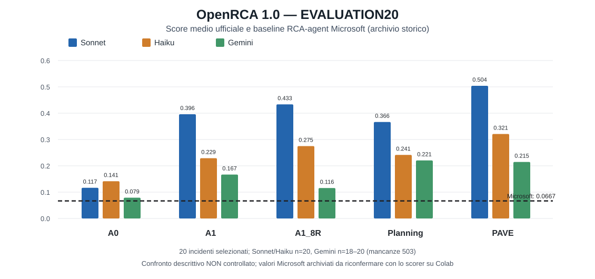

# Relazione EVALUATION20 per il relatore — 9 novembre 2026

**Stato:** campagna conclusa, scoring ufficiale completato; relazione destinata alla revisione del 10 novembre 2026. Il materiale è su un branch **solo documentale** derivato dal commit sperimentale congelato `e4845e7fe9a399e10dd2db6f320dfeaeeddf3379`. Non sono state modificate le inferenze.

## Domanda di ricerca
Analizzare come evidenze deterministiche, otto regole, planning/verifica e report strutturale-temporale influenzino accuratezza, conformità ed efficienza degli LLM nella Root Cause Analysis con **OpenRCA 1.0**.

## Disegno
- **Development:** 8 incidenti già impiegati per sviluppo e test; non equivalgono a una valutazione indipendente.
- **Evaluation:** 20 incidenti nuovi, 10 su cloudbed-1 e 10 su cloudbed-2, tutti i 7 task rappresentati, inclusi guasti multipli, selezione GT-free e assenza di sovrapposizioni temporali con coorti protette.
- **20 incidenti × 3 modelli × 5 harness × 1 replica = 300 tentativi**. Sonnet 100 completi, Haiku 100, Gemini 95 completi + 5 errori provider 503 conservati senza retry.
- Le **295 raw_response** complete sono state valutate soltanto dopo il freeze con `main/evaluate.py` originale Microsoft. Le 5 run 503 sono **missing**, non score 0.
- Tutti gli harness hanno lo stesso limite di **6 round di tool**. Il confronto primario preregistrato è **A1 − A0 all'interno di ciascun modello**.

## Harness
| Variante | Aggiunta rispetto al livello precedente |
|---|---|
| A0 | LLM ReAct con 5 tool di telemetria: baseline interna |
| A1 | Report deterministico delle evidenze, nessuna regola diagnostica |
| A1_8R | 8 regole di diagnosi |
| A1_8R_Planning | Fase esplorativa + fino a 2 round di verifica, nello stesso budget |
| A1_PAVE | Report strutturale-temporale ispirato a PAVE; NON OpenRCA 2.0 completo |

## Risultati ufficiali OpenRCA 1.0
Score medio della **risposta grezza**; strict = score esattamente 1; V2 = conformità del formato. Sonnet/Haiku n=20 per harness; Gemini n=18-20.

| Modello | Harness | Completi | Score medio | Strict | Contratto V2 | Strict e V2 |
|---|---|---:|---:|---:|---:|---:|
| Sonnet | A0 | 20 | 0.1165 | 1 | 9 | 1 |
| Sonnet | A1 | 20 | 0.3960 | 4 | 17 | 3 |
| Sonnet | A1_8R | 20 | 0.4335 | 6 | 18 | 5 |
| Sonnet | Planning | 20 | 0.3665 | 5 | 18 | 5 |
| Sonnet | PAVE | 20 | **0.5040** | **8** | 16 | 6 |
| Haiku | A0 | 20 | 0.1415 | 1 | 11 | 1 |
| Haiku | A1 | 20 | 0.2290 | 3 | 8 | 0 |
| Haiku | A1_8R | 20 | 0.2750 | 3 | 6 | 0 |
| Haiku | Planning | 20 | 0.2415 | 3 | 14 | 2 |
| Haiku | PAVE | 20 | **0.3210** | **4** | 7 | 2 |
| Gemini | A0 | 19 | 0.0789 | 0 | 19 | 0 |
| Gemini | A1 | 19 | 0.1668 | 0 | 18 | 0 |
| Gemini | A1_8R | 18 | 0.1156 | 0 | 17 | 0 |
| Gemini | Planning | 20 | **0.2205** | 2 | 20 | 2 |
| Gemini | PAVE | 19 | 0.2147 | 1 | 17 | 1 |

## Ablazione appaiata: delta score = configurazione nuova − precedente
Intervalli bootstrap percentile al 95%, 10.000 ricampionamenti per incidente; **analisi esplorativa** senza correzione per confronti multipli.

| Modello | A0→A1 (primario) | A1→8R | 8R→Planning | Planning→PAVE |
|---|---:|---:|---:|---:|
| Sonnet | **+0.2795** [0.1000, 0.4715] | +0.0375 | **−0.0670** | +0.1375 |
| Haiku | +0.0875 [−0.1000, 0.2750] | +0.0460 | −0.0335 | +0.0795 |
| Gemini | +0.0928 [−0.0278, 0.2228] (n=18) | −0.0641 (n=17) | +0.0556 (n=18) | −0.0174 (n=19) |

Sonnet A0→A1: 9 miglioramenti, 10 pari, 1 peggioramento; token **−22.7%**, tempo **−19.1%**. Sonnet 8R→Planning: score −0.0670 ma token −27.9%, tempo −22.1%. Sonnet Planning→PAVE: score +0.1375 ma token +8.0%, tempo +12.5%. L'aggiunta di livelli non migliora monotonicamente l'accuratezza.

## Conformità V2 ≠ score ufficiale
`v2_enforce` verifica la struttura e i vincoli del JSON richiesto dal task, **non** valuta la correttezza del guasto. Su 295 risposte: 215 conformi, 80 non conformi. Di queste, **68/80** supererebbero il contratto togliendo **solo** un wrapper Markdown completo (analisi ipotetica, nessuna modifica). 27 non conformi hanno score Microsoft positivo, 13 addirittura score 1. Di questi 13, 12 supererebbero V2 togliendo solo il wrapper. La metrica primaria rimane lo score sulla `raw_response` invariata.

## Confronto retrospettivo con RCA-agent originale Microsoft
Il repository Microsoft conserva gli archivi `rca/archive/agent-Market-cloudbed-1.csv` e `agent-Market-cloudbed-2.csv`. Sui **medesimi 20 `row_id`** del nostro Evaluation20, i punteggi **archiviati** producono media **0.0667**, **0/20 strict**. La configurazione Sonnet+PAVE raggiunge **0.5040**, **8/20 strict**. Le nostre 15 configurazioni hanno tutte medie descrittive maggiori.

**Cautela essenziale:** l'archivio RCA-agent è **storico** (predizioni Claude precedenti), non una run controllata con identico modello, prompt, tool, limiti di esecuzione o epoca. Le medie Gemini escludono 1–2 casi: effettuare confronto Microsoft appaiato sui soli casi riusciti, non con il 0.0667 totale. Il notebook separato di verifica Colab ricalcola la baseline con il medesimo scorer dopo allineamento di `instruction`, `task_index` e `query_index` ai `query.csv` originali: **finché non è stato eseguito, il confronto esterno è preliminare**.

## Limiti e decisioni
1. N=20 incidenti, non 300 casi indipendenti; un'unica replica per condizione non misura la variabilità intra-modello.
2. I 5 errori 503 Gemini sono missing e non necessariamente casuali; confronto appaiato per caso, anche sui 16 casi completi tra tutti gli harness Gemini.
3. Effetto harness convincente su Sonnet per A1 vs A0, meno conclusivo su Haiku/Gemini. Nessuna superiorità architetturale *causale* provata rispetto a RCA-agent Microsoft storico.
4. Ulteriori 300 run non sono necessarie prima della revisione: valutare con il relatore un eventuale **piccolo test OOD separato** delle 4 classi riservate, senza alterare il protocollo EVALUATION20. Il knowledge transfer automatico supervisionato resta future work.

## Provenienza
- [Repo Microsoft OpenRCA](https://github.com/microsoft/OpenRCA), baseline storica al commit `2a481ae63cb045c3eadbeca9eddaa10ec1151979`.
- Commit codice campagna: `e4845e7fe9a399e10dd2db6f320dfeaeeddf3379`.
- Piano SHA256: `d390d7acd3db6931c48a64bcd35757ebadf7a7dbdb12b718c1154b45e8757342`.
- Freeze SHA256: `f53effaa81fada14bab31b50ba0983e3642ff818294ac43550587e6982e4ee5f`.
- Inventario 900 file SHA256: `c12257a0ba87502090121c6393182f5f94a22ef08cef8fadbb853c4bb5addd18`.
- Score ufficiale nostro SHA256: `d2f7f6495a36c89664cb6cd864bc0f59dd55b4aa18cee29032b1d0c81748d780`.
- Scorer Microsoft sorgente SHA256: `9a1c235139266c32b0e95c7e9938591b8fe014aad4cde95580f73f13a54d53f1`.

*Questa relazione non crea run né modifica risultati; è un riepilogo della campagna congelata. Il grafico usa la baseline archiviata, da riconfermare con il ricalcolo Colab.*
